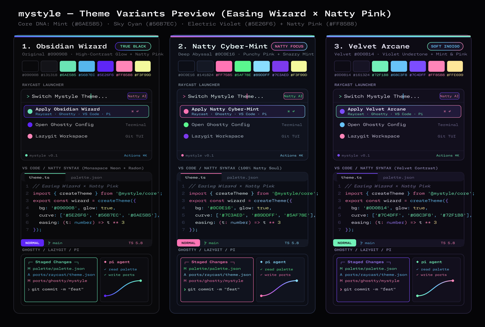

# Axolotl Theme Suite 🦎

Persönliches Design-System und Farbschema (**Axolotl**) für Terminal-Apps, TUIs, Editoren und Tools.
Kombiniert die leuchtenden Kurven-Farben von *Easing Wizard* (`Mint`, `Sky Cyan`, `Electric Violet`) mit dem *Natty Pink* (`#FF85B8`).

## Die 3 Flavors

| Flavor | Slug | Hintergrund | Charakter |
| :--- | :--- | :--- | :--- |
| **Axolotl Obsidian** | `axolotl-obsidian` | `#09090B` (True Black) | Maximaler Kontrast & Glow, Mint als Primär-Akzent |
| **Axolotl Natty** | `axolotl-natty` | `#0C0E16` (Abyssal Navy) | 100 % Natty-Soul, Pink (`#FF75B5`) als Primär-Akzent |
| **Axolotl Arcane** | `axolotl-arcane` | `#0D0B14` (Velvet Indigo) | Samtiger Violett-Unterton mit leuchtendem Mint & Pink |



## Struktur

```text
mystyle/
├── palette/
│   ├── flavors/
│   │   ├── obsidian.json     # Axolotl Obsidian
│   │   ├── natty.json        # Axolotl Natty
│   │   └── arcane.json       # Axolotl Arcane
│   └── typography.json       # Nerd-Fonts & Pixel-Accent-Fonts
├── generator/
│   └── build.mjs             # Generiert alle App-Ports aus palette/flavors/
├── ports/
│   ├── raycast/              # Raycast Themes (alle 3 Flavors)
│   ├── ghostty/              # Ghostty Terminal Themes
│   ├── pi/                   # Pi Coding Agent Themes
│   ├── vscode/               # VS Code Theme Suite Extension
│   ├── lazygit/              # Lazygit Configs
│   ├── lazydocker/           # Lazydocker Configs
│   └── herdr/                # Herdr Configs
└── assets/                   # Previews & Mockups
```
