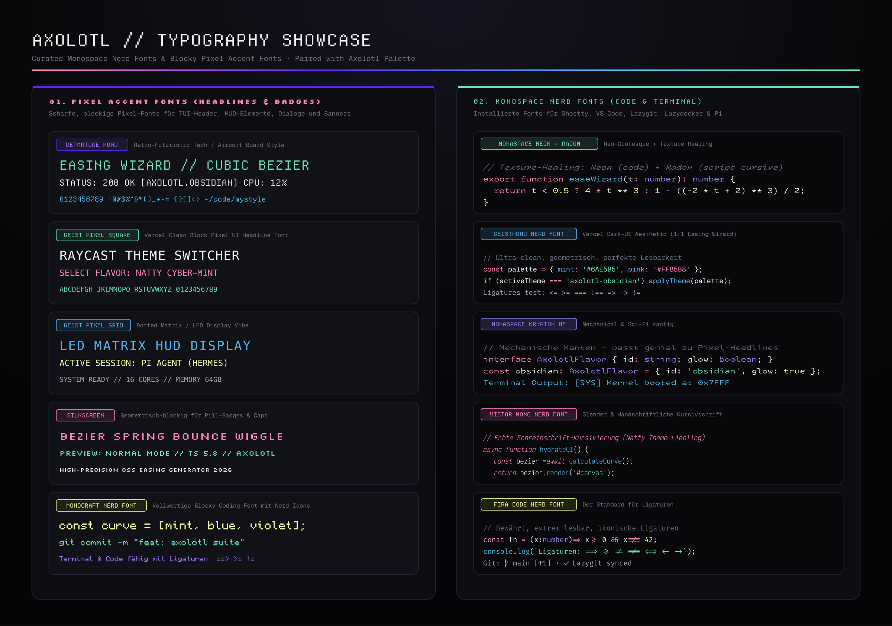

# Axolotl Theme Suite 🦎

> Ein persönliches Design-System und Farbschema für Terminal-Apps, TUIs, Editoren und Desktop-Tools.  
> Inspiriert von biolumineszenten Akzenten (*Easing Wizard* Kurven: Mint `#6AE5B5`, Sky Cyan `#56B7EC`, Electric Violet `#5E26F6`) kombiniert mit dem legendären *Natty Pink* (`#FF85B8`).

---

## 🎨 Die 3 Flavors

Die Suite kommt in drei aufeinander abgestimmten Flavors – für jeden Kontrast- und Stimmungsbedarf:

| Flavor | Slug | Hintergrund | Akzent-Fokus | Ideal für |
| :--- | :--- | :--- | :--- | :--- |
| **Axolotl Obsidian** | `axolotl-obsidian` | `#09090B` (Pitch Black) | Mint Glow & Sky Cyan | Maximaler Kontrast, OLED-Displays, nächtliches Coden |
| **Axolotl Natty** | `axolotl-natty` | `#0C0E16` (Deep Navy) | Punchy Pink & Snazzy Mint | Hommage an das originale VS Code Natty Theme |
| **Axolotl Arcane** | `axolotl-arcane` | `#0D0B14` (Velvet Indigo) | Electric Violet & Mint | Samtiger, magischer Vibe für lange Sessions |


---

## ⚡ Schnellstart & Live-Ports

### 1. Raycast Pro
Alle drei Themes können mit einem einzigen Klick oder Terminal-Befehl importiert werden:

| Flavor | 1-Klick macOS Deeplink | Web Preview |
| :--- | :--- | :--- |
| **Axolotl Obsidian** | [Direkt in Raycast importieren](raycast://theme?version=1&name=Axolotl+Obsidian&author=Tobias+Sailer&appearance=dark&colors=%2309090B%2C%23121217%2C%23F4F4F6%2C%236AE5B5%2C%236AE5B5%2C%23FF5C77%2C%23FFA666%2C%23F3F99D%2C%236AE5B5%2C%2356B7EC%2C%235E26F6%2C%23FF85B8) | [themes.ray.so Preview](https://themes.ray.so?version=1&name=Axolotl+Obsidian&author=Tobias+Sailer&appearance=dark&colors=%2309090B%2C%23121217%2C%23F4F4F6%2C%236AE5B5%2C%236AE5B5%2C%23FF5C77%2C%23FFA666%2C%23F3F99D%2C%236AE5B5%2C%2356B7EC%2C%235E26F6%2C%23FF85B8) |
| **Axolotl Natty** | [Direkt in Raycast importieren](raycast://theme?version=1&name=Axolotl+Natty&author=Tobias+Sailer&appearance=dark&colors=%230C0E16%2C%23141824%2C%23EEFFFF%2C%23FF75B5%2C%235AF78E%2C%23FF5C57%2C%23FFB86C%2C%23F3F99D%2C%235AF78E%2C%2389DDFF%2C%237C3AED%2C%23FF75B5) | [themes.ray.so Preview](https://themes.ray.so?version=1&name=Axolotl+Natty&author=Tobias+Sailer&appearance=dark&colors=%230C0E16%2C%23141824%2C%23EEFFFF%2C%23FF75B5%2C%235AF78E%2C%23FF5C57%2C%23FFB86C%2C%23F3F99D%2C%235AF78E%2C%2389DDFF%2C%237C3AED%2C%23FF75B5) |
| **Axolotl Arcane** | [Direkt in Raycast importieren](raycast://theme?version=1&name=Axolotl+Arcane&author=Tobias+Sailer&appearance=dark&colors=%230D0B14%2C%23161324%2C%23F0EEFF%2C%237C4DFF%2C%2372F1B8%2C%23FF6384%2C%23FFAB70%2C%23FFE699%2C%2372F1B8%2C%2368C3F8%2C%237C4DFF%2C%23FF85B8) | [themes.ray.so Preview](https://themes.ray.so?version=1&name=Axolotl+Arcane&author=Tobias+Sailer&appearance=dark&colors=%230D0B14%2C%23161324%2C%23F0EEFF%2C%237C4DFF%2C%2372F1B8%2C%23FF6384%2C%23FFAB70%2C%23FFE699%2C%2372F1B8%2C%2368C3F8%2C%237C4DFF%2C%23FF85B8) |

*Tipp fürs Terminal:*
```bash
open "raycast://theme?version=1&name=Axolotl+Obsidian&author=Tobias+Sailer&appearance=dark&colors=%2309090B,%23121217,%23F4F4F6,%236AE5B5,%236AE5B5,%23FF5C77,%23FFA666,%23F3F99D,%236AE5B5,%2356B7EC,%235E26F6,%23FF85B8"
```

---

## 🔤 Typografie & Schriften

Axolotl trennt bewusst Farben und Typografie:
- **Code & Terminal:** Ausgelegt für moderne Nerd-Fonts wie `Monaspace Neon NF` (+ `Radon NF` für Cursive Italics), `GeistMono Nerd Font`, `VictorMono Nerd Font` oder `FiraCode Nerd Font`.
- **Akzente & Headlines:** Blockige Pixel-Fonts wie `Departure Mono`, `Geist Pixel Square` oder `Silkscreen` für markante Banner, TUI-Kopfzeilen und Badges.



---

## 🛠️ CLI & Generator (Single Source of Truth)

Alle App-Themes werden aus den JSON-Definitionen in `palette/flavors/` generiert:

```bash
# Alle App-Ports neu generieren
node generator/build.mjs
```

---

## 📦 Roadmap: Unterstützte Apps & Tools (Ports)

Angelehnt an die modulare Struktur bekannter Theme-Ökosysteme (wie Dracula / Catppuccin):

- [x] **Raycast** (`ports/raycast/`) – Alle 3 Flavors mit 1-Klick-Import
- [ ] **Ghostty** (`ports/ghostty/`) – Terminal-Themes + Font-Profile
- [ ] **VS Code** (`ports/vscode/`) – Extension-Paket mit allen 3 Themes
- [ ] **Pi Coding Agent** (`ports/pi/`) – Custom TUI Theme
- [ ] **Lazygit** (`ports/lazygit/`) – Farb-Snippets für `.config/lazygit/config.yml`
- [ ] **Lazydocker** (`ports/lazydocker/`) – Theme-Snippets
- [ ] **Herdr** (`ports/herdr/`) – CLI / TUI Farbanpassung
- [ ] **Webseite / Showcase** (`docs/` oder `web/`) – Statische Landing-Page im Dracula/Linear-Style mit Copy-Paste & Installationsanleitungen

---

## 📁 Repository-Architektur

```text
mystyle/
├── palette/                  # Design Tokens (Single Source of Truth)
│   ├── flavors/              # Die 3 Farbpaletten
│   │   ├── obsidian.json     # Axolotl Obsidian (True Black)
│   │   ├── natty.json        # Axolotl Natty (Deep Navy)
│   │   └── arcane.json       # Axolotl Arcane (Velvet Indigo)
│   └── typography.json       # Empfohlene Nerd- und Pixel-Fonts
│
├── generator/                # Build-Pipeline & CLI-Tools
│   └── build.mjs             # Generiert alle Ports automatisiert
│
├── ports/                    # Fertige Themes pro App
│   ├── raycast/              # Raycast Pro Theme JSONs + Links
│   ├── ghostty/              # Ghostty Configs
│   ├── vscode/               # VS Code Extension
│   ├── pi/                   # Pi Coding Agent
│   ├── lazygit/              # Lazygit Konfigurationen
│   ├── lazydocker/           # Lazydocker Konfigurationen
│   └── herdr/                # Herdr Konfigurationen
│
└── assets/                   # Grafiken, Badges & Render-Showcases
    ├── variants-preview.png
    └── typography-showcase.png
```
